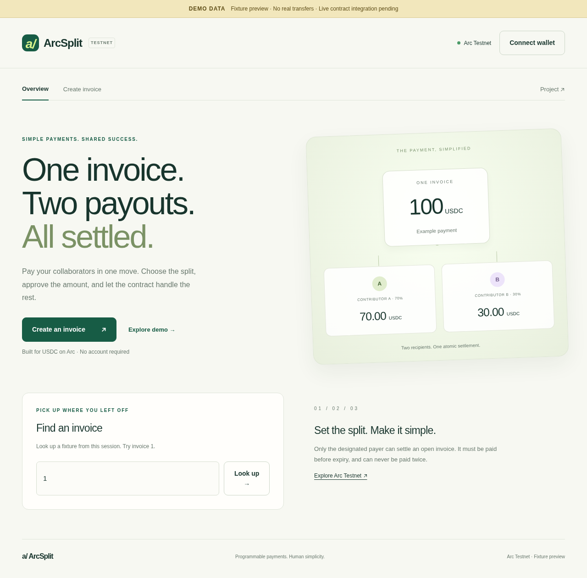

# ArcSplit

One invoice. Two contributors. One payment.

A mobile-friendly USDC invoice splitter targeting **Best Smart Contracts with Advanced Stablecoin Logic, In Arc Studio** at ETHGlobal Mumbai 2026.

**Status: Studio export preserved and live frontend integration prepared. Both Studio and Kishore contracts are tested but undeployed. Studio share URL, contract-owner source selection and real USDC payment proof remain pending. Not submission-ready.**

## Run

Node 22+ and npm:

```
npm ci
npm run dev
npm run typecheck
npm run lint
npm test
npm run build
npm run test:e2e
```

Open http://localhost:3000. Fixture views show DEMO DATA and never sign transfers. The separate Live payments tab uses actual ABI profiles, requires verified deployment configuration and deliberately requested wallet signatures. Without a deployed contract it shows “Contract not deployed — testnet payments unavailable.”

If a submitted live transaction times out, its hash is saved locally and the live write controls stay locked across reloads until the original transaction is checked. Recovery is read-only and never resubmits; payment success still requires the verified invoice event and both exact USDC transfers. Browser storage failure is surfaced because reload recovery then cannot be guaranteed.

## Team and handoff

Suraj owns frontend, root config and submission docs. Kishore owns `chain/**` and `docs/chain-handoff.md`. See [contribution protocol](CONTRIBUTING.md), [architecture and proposed ABI](docs/architecture.md), [Studio blocker and exact prompt](docs/arc-studio.md), [demo checklist](docs/demo.md) and [AI disclosure](AI_USAGE.md).

No contract address, Studio share URL or transaction evidence exists yet. The downloaded Studio source is now preserved; see [source comparison](docs/studio-comparison.md) and [live activation guide](docs/integration.md). Use official Arc Testnet USDC, not a custom token. Network sources are recorded in architecture docs. MIT for original code; dependencies retain their own licenses.

## Coordination

GitHub uses one-based issue numbers:

- [Shared architecture and ABI agreement (#1)](https://github.com/surajgojanur/arc-splitpay-mumbai-2026/issues/1)
- [Kishore: contract and ABI (#2)](https://github.com/surajgojanur/arc-splitpay-mumbai-2026/issues/2)
- [Suraj: frontend (#3)](https://github.com/surajgojanur/arc-splitpay-mumbai-2026/issues/3)
- [Kishore: deployment (#4)](https://github.com/surajgojanur/arc-splitpay-mumbai-2026/issues/4)
- [Browser integration (#5)](https://github.com/surajgojanur/arc-splitpay-mumbai-2026/issues/5)
- [Submission package (#6)](https://github.com/surajgojanur/arc-splitpay-mumbai-2026/issues/6)
- [Studio access blocker (#7)](https://github.com/surajgojanur/arc-splitpay-mumbai-2026/issues/7)

The fixture frontend passes 17 unit tests and 3 Chromium browser scenarios. See [validation and screenshot evidence](docs/demo.md#frontend-validation-evidence--2026-11-06).


