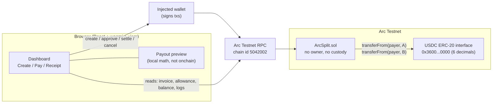
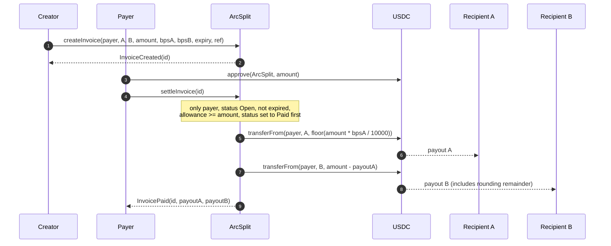
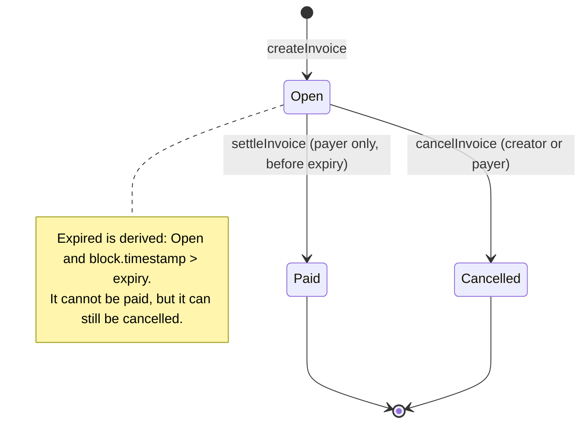

# ArcSplit architecture

ArcSplit lets one payer settle a single USDC invoice that is split atomically between two recipients. The contract never holds funds: it pulls USDC from the payer and sends it straight to both recipients in one transaction.

## System overview



## Settlement sequence



## Invoice state machine



## Contract rules

| Rule | How it is enforced |
| --- | --- |
| Only the designated payer settles | `NotPayer` revert for everyone else, including the creator and recipients |
| Allowance required | `InsufficientAllowance(allowance, amount)` before any transfer |
| No duplicate payment | Status moves `Open` to `Paid` before transfers; a second call reverts `InvoiceNotOpen(Paid)` |
| Cancel unpaid only | Creator or payer, while `Open`; cannot cancel `Paid` or already `Cancelled` |
| No settling cancelled or expired | `InvoiceNotOpen(Cancelled)` and `InvoiceExpired` (expiry is inclusive) |
| No lost USDC | A gets `floor(amount * bpsA / 10000)`, B gets `amount - payoutA`, so the two always sum to the amount |
| No zero payouts | Creation rejects any split where either recipient would receive 0 base units |
| No privileged withdrawals | No owner, admin, pause, fee or upgrade path. The contract has no function that moves tokens it holds, and it never holds any |
| Atomic | Both `transferFrom` calls are in one transaction; a failure (for example a blocklisted recipient) reverts everything |

## Real data vs test data

| Where | Source |
| --- | --- |
| Invoice fields, status, expiry, payouts, allowance, balance | Read from Arc Testnet |
| Receipt transaction hash | From `InvoicePaid` logs or the transaction just sent from this browser |
| Payout preview in the create form | Computed locally with the same arithmetic as the contract, labeled as not onchain |
| "Example splits" chips (50/50, 70/30, 80/20) | Fill the percentage field only. No addresses, hashes or results are fabricated |
| Foundry tests | Use mock ERC-20 contracts in `chain/test/ArcSplit.t.sol`; never deployed |

## Layout of this package (`chain/`)

```
chain/src/ArcSplit.sol               the contract
chain/src/interfaces/IArcSplit.sol   integration interface
chain/test/ArcSplit.t.sol            60 Foundry tests (58 unit/fuzz + 2 invariants)
chain/script/DeployArcSplit.s.sol    Arc Testnet deployment script (testnet only)
chain/abi/ArcSplit.json              ABI array
chain/deployments/                   template only until a real deployment exists
chain/docs/                          this file, INTEGRATION_CONTRACT.md, SECURITY.md
```
