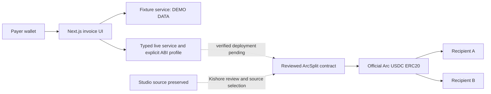

# Architecture and contract profiles

No database. Contract state and indexed events are the future source of truth. Fixtures live only in browser memory and never produce chain hashes or explorer payment proof.

## Original proposal — implemented by Kishore; Studio differences below

Conceptual operations: createInvoice, getInvoice, payInvoice, cancelInvoice.
Suggested createInvoice(address recipientA,address recipientB,uint256 amount,uint16 shareBps,uint64 expiry); designated payer = msg.sender. Suggested getInvoice(uint256 id) returns payer, recipientA, recipientB, amount, shareBps, expiry, status. Suggested payInvoice(uint256 id), cancelInvoice(uint256 id). Optional memo hash omitted unless agreed. These were the original proposals; Kishore implemented them in PR #9. Exact read-only ABI snapshots now exist in the frontend. Studio differs as described below.

Proposed events InvoiceCreated(id indexed,payer indexed,recipientA,recipientB,amount,shareBps,expiry), InvoicePaid(id indexed,payer indexed,amount,payoutA,payoutB), InvoiceCancelled(id indexed,payer indexed). Kishore confirmed these encodings in issue #1. Final source/profile selection and deployment metadata still require owner review.

Use uint atomic amounts: ERC20 USDC has 6 decimals; native gas USDC has 18. Never mix these units. Compute A = floor(amount * shareBps / 10000), B = amount - A; require both nonzero. Amounts never use floating point. Only designated payer can pay or cancel; open, unexpired invoices can settle exactly once. Contract must enforce all conditions independently of UI. Safe ERC20 transfers and atomic rollback are Kishore's responsibility.

## Deployment handoff

Kishore exports `chain/abi/ArcSplit.json` (ABI array or documented artifact) and `chain/deployments/arc-testnet.json` with chainId, contractAddress, usdcAddress, usdcDecimals, deploymentBlock, deploymentTransactionHash, compilerVersion, sourceCommit and explorerUrl. Confirm schema in issue first. Suraj consumes artifacts read-only, implements live adapter and validates bytecode, chain and USDC configuration before enabling writes. Live writes remain disabled until then.

## Verified network sources (2026-11-06)

https://docs.arc.io/arc/references/connect-to-arc : Arc Testnet 5042002, https://rpc.testnet.arc.io, https://explorer.testnet.arc.io.
https://docs.arc.io/arc/references/contract-addresses : official USDC ERC20 0x3600000000000000000000000000000000000000, 6 decimals. Native gas precision 18; a single underlying balance.

Review workflow: separate branches and PRs; Kishore acknowledges ABI issue, Suraj verifies artifacts and checks before integrating. Never edit cross-owner files without an issue request.

## Integration update — Studio and independent contract profiles

The original proposal above is now implemented in Kishore PR #9 (a3ac1b7), with flat getInvoice returns and exclusive expiry. Studio generated a different contract. See [comparison](studio-comparison.md). Frontend explicitly selects `studio-v1` or `kishore-v1` via reviewed public deployment metadata; it never guesses a method or decodes one ABI as the other. No profile is activated by default. Exact ABI snapshots are in `web/lib/contracts/`; Studio original ABI and source are in `docs/studio-original/`. Neither contract was imported into chain/** by Suraj.

The domain service (`web/lib/live-service.ts`) normalizes profile-specific invoice shapes for the live UI and uses `web/lib/live-gateway.ts` for viem RPC/wallet access. FixtureAdapter remains an isolated offline service with DEMO DATA labels. The live panel contains no fixture receipts/balances. UI timestamps are milliseconds/local display; contract expiry/createdAt/paidAt are bigint Unix seconds. Conversion occurs explicitly at the live-service boundary.

Live activation requires a reviewed `web/config/deployment.json`: chain/profile/address, official USDC/6 decimals, deployment block and receipt hash, expected runtime code hash, ABI hash and official explorer URL. The service verifies chain ID, bytecode hash, usdc(), decimals(), successful direct-deployment receipt/block/address before signatures. All writes simulate, recheck the current wallet account/network, request a human signature and wait for a successful matching receipt. Creation ID comes from InvoiceCreated, never a guessed counter. Payment receipts require InvoicePaid and both exact USDC Transfer events. Confirmation timeouts retain the submitted hash and block retry until recovery. Event history is paginated and labels limited/unavailable history explicitly. Metadata must be reviewed against the selected source/build; a runtime hash alone is not an audit or ABI discovery mechanism.
