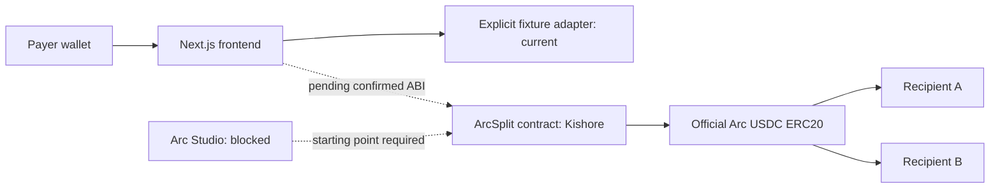

# Architecture and proposed interface

No database. Contract state and indexed events are the future source of truth. Fixtures live only in browser memory and never produce chain hashes or explorer payment proof.

## Interface proposal — requires Kishore acknowledgement
Conceptual operations: createInvoice, getInvoice, payInvoice, cancelInvoice.
Suggested createInvoice(address recipientA,address recipientB,uint256 amount,uint16 shareBps,uint64 expiry); designated payer = msg.sender. Suggested getInvoice(uint256 id) returns payer, recipientA, recipientB, amount, shareBps, expiry, status. Suggested payInvoice(uint256 id), cancelInvoice(uint256 id). Optional memo hash omitted unless agreed. These are proposals only; frontend contains no speculative contract ABI.

Proposed events InvoiceCreated(id indexed,payer indexed,recipientA,recipientB,amount,shareBps,expiry), InvoicePaid(id indexed,payer indexed,amount,payoutA,payoutB), InvoiceCancelled(id indexed,payer indexed). Kishore must confirm signatures, indexed fields, status encoding, ID origin, cancellation authority, rounding and deployment block in GitHub issue before implementation.

Use uint atomic amounts: ERC20 USDC has 6 decimals; native gas USDC has 18. Never mix these units. Compute A = floor(amount * shareBps / 10000), B = amount - A; require both nonzero. Amounts never use floating point. Only designated payer can pay or cancel; open, unexpired invoices can settle exactly once. Contract must enforce all conditions independently of UI. Safe ERC20 transfers and atomic rollback are Kishore's responsibility.

## Deployment handoff
Kishore exports `chain/abi/ArcSplit.json` (ABI array or documented artifact) and `chain/deployments/arc-testnet.json` with chainId, contractAddress, usdcAddress, usdcDecimals, deploymentBlock, deploymentTransactionHash, compilerVersion, sourceCommit and explorerUrl. Confirm schema in issue first. Suraj consumes artifacts read-only, implements live adapter and validates bytecode, chain and USDC configuration before enabling writes. Live writes remain disabled until then.

## Verified network sources (2026-11-06)
https://docs.arc.io/arc/references/connect-to-arc : Arc Testnet 5042002, https://rpc.testnet.arc.io, https://explorer.testnet.arc.io.
https://docs.arc.io/arc/references/contract-addresses : official USDC ERC20 0x3600000000000000000000000000000000000000, 6 decimals. Native gas precision 18; a single underlying balance.

Review workflow: separate branches and PRs; Kishore acknowledges ABI issue, Suraj verifies artifacts and checks before integrating. Never edit cross-owner files without an issue request.
